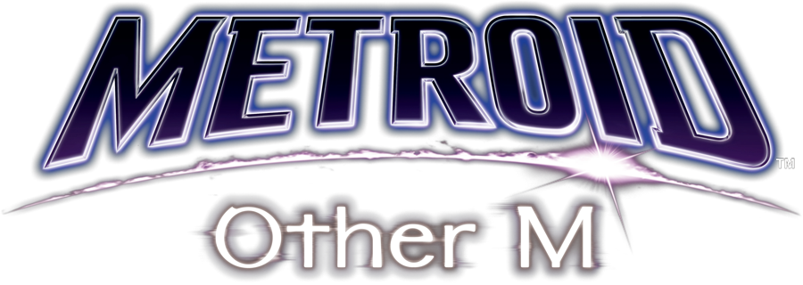

# Metroid: Other M Patch

Play **Metroid: Other M** (Wii) with a **GameCube controller** or a **Classic
Controller** instead of the sideways/upright Wii Remote, and without a Wii Remote
at all. Works with the USA (`R3OE01`, Rev 0 and Rev 1), European (`R3OP01`,
Rev 0 and Rev 1) and Japanese (`R3OJ01`) releases.

The patches are applied to your own copy of the game: drop a clean `.wbfs` or
`.iso` onto the patcher and play the result on a Wii (USB loader) or in
Dolphin. Nothing from the game is included in this repository.



## Status

Tested in **Dolphin** on the USA Rev 0 disc (both the Gecko codes and a disc
image rebuilt by the patcher's own wit pipeline), with no Wii Remote connected and a
scripted GameCube pad: the game boots past its "Wii Remote disconnected"
screen, advances with A, and the sticks, C-stick and buttons arrive in the
game's controller state as listed below. **Not yet tested on a real Wii**, and
not yet played through. The other four discs carry a byte-identical `main.dol`
(the patcher checks this), so the same code applies to them, but only the USA
Rev 0 disc has been booted. See [On a real Wii](#on-a-real-wii).

## Controls

The Classic Controller layout is Vague Rant's. The GameCube pad is presented
to the game as a Classic Controller, so it plays the same way.

| GameCube | Classic Controller | Wii Remote + Nunchuk | Action |
| --- | --- | --- | --- |
| Control stick | Left stick | Nunchuk stick / D-pad | Move · aim in first person |
| C-stick | Right stick | pointer | Pointer (first person) |
| A | A / ZR | A | Morph Ball · shoot (first person) |
| B | B | 2 | Jump |
| Y | Y | 1 | Shoot |
| X | X | tilt up | Concentration (recharge) |
| R | ZL | B | Free look · lock on (first person) |
| L | L / R | — | Pointer on / off |
| Z | Minus | Minus | Skip scenes |
| Start | Plus | Plus | Pause |
| D-pad | D-pad | D-pad | Menus · Sense Move |
| — | Home | Home | Home Menu (Classic Controller only) |

This game switches control scheme when the Wii Remote points at the screen, so
the pointer is toggled by hand: press **L** to turn it on or off. Scenes that
force first-person mode do not turn it on for you. At the training step that
asks you to point at the screen and hold B, press **L**, aim with the right
stick and hold **R**/**ZL**. The Riivolution patch does not include the fix for
this step; use the patched disc image or the Gecko codes.

There is no HOME button on a GameCube pad, so the HOME Menu needs a Wii Remote
or a Classic Controller.

## Installing

### Patch your disc image

You need a clean `.wbfs` or `.iso` of the game. Download the patcher for your
system from the releases page (or the artifacts of the latest CI run), or run
it from source (needs Python 3 with tkinter and
[Wiimms ISO Tool](https://wit.wiimm.de/) (`wit`) on your `PATH`):

```bash
python3 tools/gui.py
```

Tick the patches you want, then drop the image onto the window (or click to
choose it). The patcher checks the disc id, patches `sys/main.dol`, rebuilds the
image in the same format and replaces your file, keeping the original next to
it as `<name>.bak`. Other releases, and images already modified by something
else, are refused rather than corrupted. You can run it again later to add
another patch. The GameCube option always includes the Classic Controller code,
because the pad is presented to the game as one.

There is a command-line twin:

```bash
python3 tools/patch_disc.py "Metroid - Other M (USA) (En,Fr,Es).wbfs" --cc --gc
```

The patcher works next to the image (a disc is several GB), so that folder
needs room for about one extra copy of the game while it runs.

### Gecko codes (Dolphin)

Copy `codes/<disc id>.ini` (`R3OE01`, `R3OP01` or `R3OJ01`) into Dolphin's
`GameSettings` folder and enable both codes under **Properties → Gecko
Codes**. Set GameCube Port 1 to a Standard Controller. No Wii Remote is
needed: set the Wii Remote source to *None*.

The same codes are in `codes/<disc id>.txt` in the plain layout loaders read.
On a real console prefer the patched disc: a loader's own code handler and the
patched disc both want the Wii's low memory.

### Riivolution

`riivolution/<disc id>.xml` is a Riivolution patch with one switch per feature.
Put it in your Riivolution folder (or Dolphin's `Load/Riivolution`) and enable
the options you want. It matches on the disc id, so it cannot be applied to the
wrong game.

### Which release do I have?

The disc id is the first six characters of the disc: `R3OE01` USA, `R3OP01`
Europe, `R3OJ01` Japan. USA and Europe have a Rev 0 and a Rev 1; all of them
are supported.

## On a real Wii

The GameCube side follows the approach of
[Barrel Blast Patch](https://github.com/quatric/Barrel-Blast-Patch), which
drives the console's Serial Interface hardware directly and was debugged on a
real Wii. This port has only been run in Dolphin, and Dolphin accepts things
silicon does not, so expect to find a bug or two on hardware. What is checked
in Dolphin is everything downstream of the SI registers; the SI polling code is
the part that is inherited rather than re-tested.

Plug the GameCube controller into **port 1** *before* starting the game. Hot-plugging
is handled in code (the game is told a controller connected or left) but has not been
tried, so treat it as untested.

With a Classic Controller on a Wii U (vWii) injection, enable *Force Classic
Controller Connected*.

## Credits

- **Vague Rant** — the Classic Controller / Nunchuk support this is built on
  ([GBAtemp thread](https://gbatemp.net/threads/new-classic-controller-hacks.659837/)).
- **Barrel Blast Patch / City Folk Patch** — the GameCube pad technique.

See [docs/TECHNICAL.md](docs/TECHNICAL.md) for how it works.
